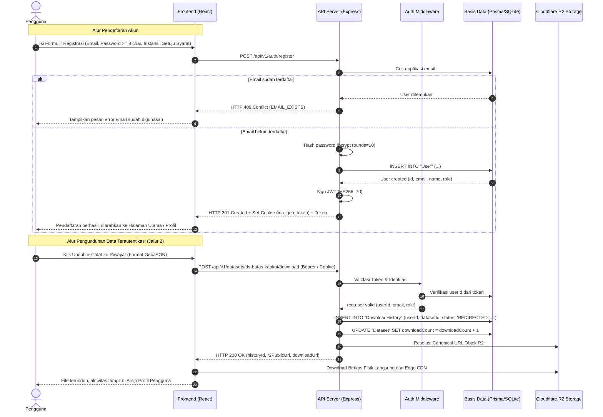

# Alur Autentikasi Pengguna & Manajemen Sesi (Authentication Flow)

**Ina-Geoportal Web App Redesign v2.0**  
*Dokumen Arsitektur Teknis Sistem Keamanan dan Autentikasi Pengguna*

---

## 1. Ringkasan Eksekutif

Sistem autentikasi Ina-Geoportal Web App Redesign v2.0 mengadopsi arsitektur autentikasi berbasis email/kata sandi lokal yang aman, persisten, dan mendukung dual-token authorization (HttpOnly Session Cookie & Bearer JWT). Sistem ini menjamin bahwa seluruh data identitas pengguna dan aktivitas tersimpan nyata di basis data relasional (SQLite pada lingkungan pengembangan lokal, PostgreSQL pada Vercel Production), tanpa simulasi, tanpa mock dummy, dan tanpa penyimpanan state sementara di memori peramban.

---

## 2. Diagram Alur Autentikasi (Authentication Flowchart)

```mermaid
flowchart TD
    subgraph Klien["Frontend (React / Vite)"]
        UI_Reg["Halaman Pendaftaran (/register)"]
        UI_Log["Halaman Masuk (/login)"]
        UI_Prof["Halaman Profil Pengguna (/profile)"]
        Store["Auth Store (Zustand)"]
    end

    subgraph Backend["API Gateway (Express.js)"]
        MW_Rate["Rate Limiter Middleware"]
        Val_Reg["Validasi Skema Zod (Password >= 8, Confirm, Terms)"]
        Val_Log["Validasi Kredensial Login"]
        JWT_Gen["JWT Signer (HS256, 7 Days)"]
        MW_Auth["Auth Middleware (Bearer / Cookie Extractor)"]
    end

    subgraph Database["Prisma ORM & Basis Data"]
        DB_User[("Tabel User (Bcrypt Hash)")]
        DB_Audit[("Tabel DownloadHistory & Bookmark")]
    end

    UI_Reg -->|POST /api/v1/auth/register| MW_Rate
    MW_Rate --> Val_Reg
    Val_Reg -->|Cek Duplikasi Email| DB_User
    Val_Reg -->|Hash Password via Bcrypt (salt=10)| DB_User
    DB_User -->|User Created| JWT_Gen
    JWT_Gen -->|Set HttpOnly Cookie + Kirim Bearer JWT| Store

    UI_Log -->|POST /api/v1/auth/login| MW_Rate
    MW_Rate --> Val_Log
    Val_Log -->|Bcrypt Compare Hash| DB_User
    DB_User -->|Kredensial Valid| JWT_Gen
    JWT_Gen -->|Set HttpOnly Cookie ina_geo_token + Token| Store

    UI_Prof -->|GET /api/v1/user/profile| MW_Auth
    MW_Auth -->|Verifikasi JWT Payload| DB_User
    DB_User -->|Ambil Data Profil & Relasi| DB_Audit
    DB_Audit -->|Response Profil & Audit Trail| UI_Prof
```

---

## 3. Spesifikasi Endpoint Autentikasi

### 3.1 Pendaftaran Akun (`POST /api/v1/auth/register`)
- **Akses:** Publik (tanpa token).
- **Validasi Input:**
  - `name`: String minimal 2 karakter.
  - `email`: Format email valid, bersifat unik di tabel `User`.
  - `password`: String minimal 8 karakter.
  - `confirmPassword`: Wajib sama persis dengan `password`.
  - `institution`: String nama instansi/organisasi pengguna.
  - `agreeTerms`: Boolean wajib bernilai `true`.
- **Proses Keamanan:**
  - Pengecekan duplikasi email secara langsung ke basis data. Jika sudah terdaftar, mengembalikan kode status HTTP `409 Conflict` dengan kode error `EMAIL_EXISTS`.
  - Hashing kata sandi menggunakan `bcryptjs` dengan *salt rounds* = 10. Nilai *plain-text* kata sandi tidak pernah disimpan atau dicatat ke log.
  - Pembuatan record di tabel `User` dengan `role: "USER"`, `provider: "local"`.
  - Penerbitan JWT 7 hari dan penyetelan *HttpOnly Cookie* `ina_geo_token`.

### 3.2 Masuk Akun (`POST /api/v1/auth/login`)
- **Akses:** Publik.
- **Validasi & Verifikasi:**
  - Pengambilan data pengguna dari tabel `User` berdasarkan `email`.
  - Jika email tidak ditemukan: Mengembalikan HTTP `401 Unauthorized` (`INVALID_CREDENTIALS`).
  - Verifikasi kata sandi menggunakan `bcrypt.compare(password, user.password)`.
  - Jika kata sandi salah: Mengembalikan HTTP `401 Unauthorized` (`INVALID_CREDENTIALS`).
  - Pesan error login sengaja diseragamkan (*generic*) guna mencegah serangan *user enumeration*.
- **Penerbitan Sesi:**
  - JWT ditandatangani dengan rahasia `JWT_SECRET`.
  - Cookie `ina_geo_token` disetel dengan parameter keamanan: `httpOnly: true`, `sameSite: 'lax'`, `maxAge: 7 * 24 * 3600 * 1000`.

### 3.3 Keluar Sesi (`POST /api/v1/auth/logout`)
- **Akses:** Publik / Terautentikasi.
- **Tindakan:**
  - Menghapus cookie `ina_geo_token` dengan menyetel `maxAge: 0` dan `expires: new Date(0)`.
  - Menginstruksikan client Zustand untuk mengosongkan token dan state sesi pengguna.

### 3.4 Sesi Aktif (`GET /api/v1/auth/me`)
- **Akses:** Wajib Login (Protected via `authMiddleware`).
- **Tindakan:**
  - Membaca token dari header `Authorization: Bearer <token>` atau cookie `ina_geo_token`.
  - Memverifikasi integritas JWT.
  - Mengambil data mutakhir pengguna dari basis data (menghapus field `password`).

---

## 4. Mekanisme Dual-Token Authorization

Middleware autentikasi (`server/src/middleware/authMiddleware.ts`) dirancang dengan dukungan ganda:

1. **Header Authorization (Bearer Token):**  
   Digunakan oleh integrasi API terprogram, panggilan fetch/Axios klien, dan rangkaian pengujian integrasi Supertest/Vitest:
   ```http
   Authorization: Bearer <token_jwt>
   ```

2. **HttpOnly Secure Cookie (`ina_geo_token`):**  
   Disetel secara otomatis oleh peramban web pada saat login atau registrasi. Melindungi aplikasi dari potensi serangan *Cross-Site Scripting (XSS)* yang mencoba mencuri token dari JavaScript context:
   ```http
   Cookie: ina_geo_token=<token_jwt>
   ```

Middleware mengekstrak token dari header terlebih dahulu. Jika header tidak tersedia, middleware secara mulus beralih membaca cookie `ina_geo_token`.

---

## 5. Sequence Diagram: Siklus Pendaftaran dan Permohonan Data



---

## 6. Prinsip Multi-Tenant Data Isolation

Seluruh endpoint personal (profil, markah buku, riwayat unduh) menerapkan *tenant isolation* ketat:
- Kueri basis data selalu mengunci klausa `where: { userId: req.user.userId }`.
- Pengguna A tidak dapat melihat, mengubah, atau menghapus riwayat unduhan maupun bookmark milik Pengguna B.
- Setiap entitas riwayat diikat secara referensial terhadap *Foreign Key* pengguna (`userId`) yang terindeks dan terisolasi.
