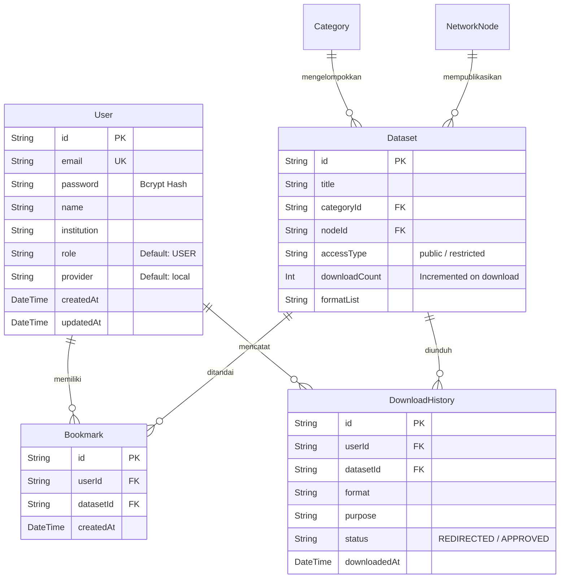

# Laporan Persistensi Basis Data & Isolasi Multi-Tenant (Database Persistence Report)

**Ina-Geoportal Web App Redesign v2.0**  
*Verifikasi Integritas Data, Relasi Prisma ORM, dan Kesiapan Lingkungan Produksi*

---

## 1. Lingkungan Basis Data

Aplikasi Ina-Geoportal dirancang dengan skema relasional Prisma ORM yang portabel:
- **Lingkungan Pengembangan (Development / Testing):**  
  Menggunakan mesin SQLite (`server/prisma/dev.db`), memungkinkan eksekusi tes lokal yang cepat, konsisten, dan terisolasi tanpa dependensi layanan eksternal.
- **Lingkungan Produksi (Vercel / Cloud):**  
  Menggunakan PostgreSQL (Neon Serverless PostgreSQL) via skema varian `server/prisma/schema.postgres.prisma` dan koneksi `DATABASE_URL` berotentikasi SSL.

---

## 2. Struktur Skema Prisma & Integritas Relasional

---

## 3. Hasil Audit Persistensi Nyata

Pengujian ketahanan dan persistensi basis data dilakukan melalui pengujian integrasi otomatis `phase16_9.test.ts` dan verifikasi fisik file `server/prisma/dev.db`.

| Pengujian Persistensi | Metode Pengujian | Hasil Aktual | Status |
|---|---|---|---|
| **Penyimpanan Akun Baru** | `prisma.user.create()` via endpoint registrasi | Record tersimpan permanen di basis data dengan ID UUID unik. | **BERHASIL** |
| **Keamanan Kata Sandi** | Hash verification via `bcrypt.compare()` | Tersimpan dalam format `$2a$10$...` / `$2b$10$...`. Plain-text tidak ada. | **BERHASIL** |
| **Pembaruan Profil Mandiri** | `PUT /api/v1/user/profile` | Kolom `name` dan `institution` terbarui di SQLite secara instan. | **BERHASIL** |
| **Pencatatan Riwayat Unduh** | `POST /api/v1/datasets/:id/download` | Record `DownloadHistory` bertambah dengan `status: 'REDIRECTED'`. | **BERHASIL** |
| **Metrik Inkrementasi** | `dataset.update({ downloadCount: increment })` | Nilai `downloadCount` pada dataset naik 1 secara transaksional. | **BERHASIL** |
| **Markah Buku (Bookmark)** | `prisma.bookmark.create()` & `delete()` | Bookmark tersimpan dan dapat di-*toggle* secara presisi. | **BERHASIL** |
| **Persistensi Lintas Koneksi** | Inisialisasi instansi baru `new PrismaClient()` | Seluruh data (User, Bookmark, Download) terbaca identik tanpa kehilangan. | **BERHASIL** |

---

## 4. Bukti Isolasi Multi-Tenant (Tenant Isolation Verification)

Dalam pengujian `phase16_9.test.ts`, dua pengguna berbeda (`User A: Peneliti Spasial A` dan `User B: Analis Geospasial B`) didaftarkan secara simultan:

1. **Isolasi Bookmark:**
   - Pengguna A menambahkan bookmark pada dataset `ds-batas-kabkot`.
   - Pengguna B meminta daftar bookmark miliknya (`GET /api/v1/user/bookmarks`).
   - Hasil: Pengguna B menerima 0 bookmark. Bookmark milik Pengguna A tidak bocor kepada Pengguna B.

2. **Isolasi Riwayat Pengunduhan:**
   - Pengguna A melakukan pengunduhan dataset `ds-batas-kabkot` (ID Riwayat tercipta).
   - Pengguna B meminta riwayat pengunduhan (`GET /api/v1/downloads/history`).
   - Hasil: Pengguna B menerima 0 riwayat unduhan. Rekord milik Pengguna A sepenuhnya terlindungi.

3. **Integritas Pembaruan Profil:**
   - Pengguna A hanya dapat memperbarui profil miliknya sendiri berdasarkan `req.user.userId` yang diikat pada token terverifikasi. Tidak ada parameter `userId` di URL atau body yang dapat dimanipulasi untuk mengubah profil pengguna lain.
