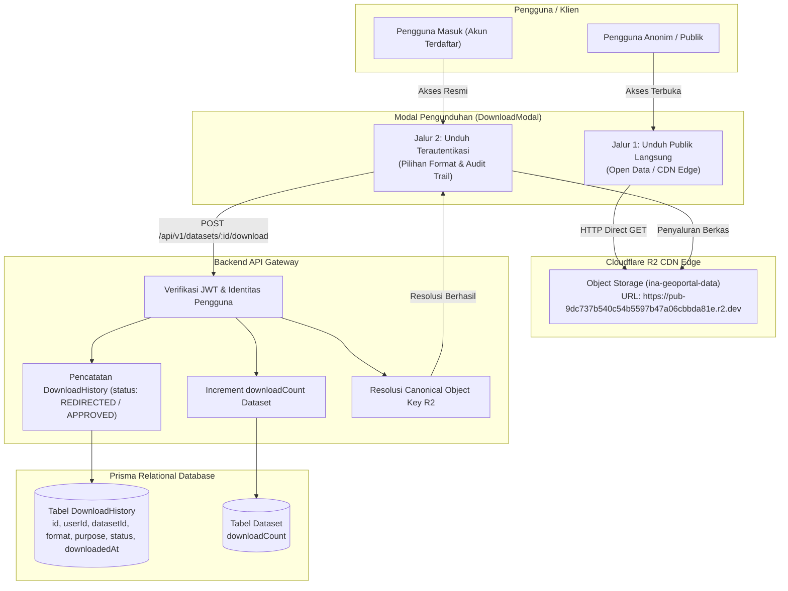

# Arsitektur Pelacakan & Pengunduhan Data (Download Tracking Architecture)

**Ina-Geoportal Web App Redesign v2.0**  
*Spesifikasi Teknis Sistem Pengunduhan Dua Jalur (Dual-Track Geospatial Download)*

---

## 1. Konsep Desain: Dual-Track Download Architecture

Arsitektur penyimpanan geospasial Ina-Geoportal v2.0 (Phase 16.4 s.d. 16.9) mengimplementasikan pemisahan yang jelas dan tegas antara **Jalur 1: Unduh Publik (Tanpa Login)** dan **Jalur 2: Unduh Terautentikasi (Dicatat di Basis Data)**.



---

## 2. Rincian Kedua Jalur Pengunduhan

### 2.1 Jalur 1 — Unduh Publik (Tanpa Login)
- **Karakteristik:** Akses terbuka (*Open Geospatial Data*), bebas unduh, tanpa hambatan otentikasi.
- **Penyimpanan:** Berkas disajikan langsung dari jaringan tepi (*Edge CDN*) Cloudflare R2 bucket `ina-geoportal-data` menggunakan `R2_PUBLIC_URL` (`https://pub-9dc737b540c54b5597b47a06cbbda81e.r2.dev`).
- **Aktivitas Audit:** Tidak disimpan ke riwayat akun karena pengguna anonim tidak memiliki identitas `userId`.
- **Ketentuan Khusus:** Jika dataset berstatus *Restricted* (Terbatas), Jalur 1 dinonaktifkan dan pengguna diarahkan ke Jalur 2.

### 2.2 Jalur 2 — Unduh Terautentikasi (Audit Trail di Basis Data)
- **Karakteristik:** Akses resmi untuk pengguna yang telah melakukan registrasi dan masuk ke sistem.
- **Validasi Sesi:** Backend memeriksa token sesi pengguna melalui header `Authorization: Bearer` atau cookie `ina_geo_token`.
- **Pencatatan Basis Data:**
  - `userId`: Diambil secara aman dari payload token JWT yang telah diverifikasi (mencegah pemalsuan identitas).
  - `datasetId`: ID dataset yang diminta.
  - `format`: Format berkas yang dipilih (`geojson`, `shp`, `kml`).
  - `purpose`: Tujuan penggunaan data (wajib diisi minimal 5 karakter untuk dataset terbatas; bernilai default untuk dataset publik).
  - `status`: Disimpan secara jujur sebagai `REDIRECTED` (atau `APPROVED` untuk data terbatas), mencerminkan bahwa server telah menyetujui dan mengarahkan klien ke lokasi berkas CDN R2 yang sah.
  - `downloadedAt`: Timestamp waktu pencatatan.
- **Inkrementasi Metrik:** Kolom `downloadCount` pada tabel `Dataset` dinaikkan sebanyak 1 secara otomatis.

---

## 3. Spesifikasi API Riwayat Pengunduhan (Download History API)

### 3.1 Endpoint `GET /api/v1/downloads/history`
Endpoint resmi untuk mengambil riwayat unduhan pengguna yang terautentikasi.
- **Parameter Kueri (Query Parameters):**
  - `page`: Nomor halaman (integer, default: 1).
  - `limit`: Jumlah data per halaman (integer, default: 20, max: 100).
  - `categoryId`: Filter berdasarkan kategori dataset.
  - `startDate`: Filter rentang tanggal awal (`YYYY-MM-DD`).
  - `endDate`: Filter rentang tanggal akhir (`YYYY-MM-DD`).
  - `search`: Pencarian nama judul dataset.
- **Struktur Respon:**
  ```json
  {
    "success": true,
    "message": "Riwayat pengunduhan berhasil dimuat",
    "data": [
      {
        "id": "cm7...history_id",
        "userId": "user_uuid",
        "datasetId": "ds-batas-kabkot",
        "format": "geojson",
        "purpose": "Analisis Spasial Tata Ruang",
        "status": "REDIRECTED",
        "downloadedAt": "2026-11-20T06:37:45.123Z",
        "storageSource": "Cloudflare R2",
        "dataset": {
          "id": "ds-batas-kabkot",
          "title": "Batas Wilayah Administrasi Kabupaten/Kota",
          "category": { "id": "cat-batas", "name": "Batas Wilayah" },
          "node": { "id": "node-big", "name": "Badan Informasi Geospasial (BIG)" }
        }
      }
    ],
    "meta": {
      "page": 1,
      "limit": 20,
      "total": 1,
      "totalPages": 1
    }
  }
  ```

### 3.2 Endpoint Kompatibilitas `GET /api/v1/user/downloads`
Menyediakan antarmuka yang mendukung integrasi komponen lama atau filter langsung pada tab profil pengguna.

---

## 4. UI & Pengalaman Pengguna (Frontend Integration)

1. **`DownloadModal.tsx`:**  
   Menampilkan komparasi jelas antara **Jalur 1 (Unduh Langsung dari Cloud R2)** dan **Jalur 2 (Unduh Resmi & Catat ke Riwayat)**. Pemilihan format (GeoJSON, Shapefile, KML) terintegrasi rapi dengan feedback visual real-time setelah proses pengunduhan dimulai.

2. **`DownloadHistoryTable.tsx`:**  
   Menampilkan tabel riwayat unduhan pada profil pengguna lengkap dengan:
   - Judul dataset dan ID.
   - Kategori dataset.
   - Format berkas yang diminta.
   - Sumber penyimpanan (`Cloudflare R2` badge).
   - Waktu unduh (tanggal & jam).
   - Status badge dinamis (`REDIRECTED`, `APPROVED`, `COMPLETED`).
   - Tombol unduh ulang berkas.

3. **`UserProfilePage.tsx`:**  
   Dilengkapi fasilitas penyaringan riwayat unduh secara langsung (pencarian kata kunci judul dataset dan dropdown kategori) serta tombol penyegaran instan (*refresh*).
